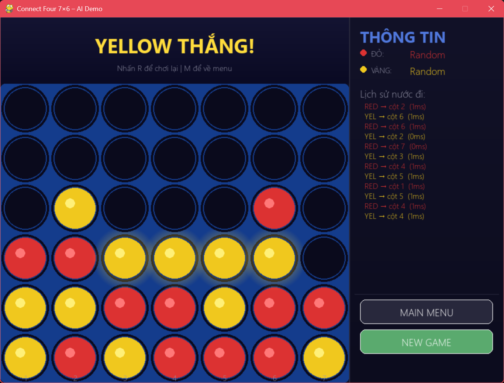

# Connect Four 7×6 – Game AI đa cấp độ

[](https://github.com/linh-245/TTNTNC-GameAI-nhom11/actions/workflows/test.yml)

Đề tài cuối kỳ môn **Trí tuệ nhân tạo nâng cao** – Nhóm 11 – GVHD: TS. Đỗ Như Tài.
Xây dựng game Connect Four và các tác tử AI từ Random đến Alpha-Beta, MCTS, mạng nơ-ron, học tăng cường và AlphaZero-MCTS, sau đó so sánh bằng giải đấu vòng tròn (có Wilson CI) và đối chiếu với solver.



## Thành viên

| Họ tên | MSSV | GitHub | Phụ trách |
|---|---|---|---|
| Nguyễn Kiều Linh (nhóm trưởng) | 3124720039 | linh-245 | Engine, giao diện, Cấp 1–2, kiểm thử, solver, tích hợp |
| Nguyễn Huỳnh Mai | 3124720043 | chloestudy0043-stack | Alpha-Beta, MCTS, giải đấu, ablation, bản đầu AZ-MCTS |
| Nguyễn Lương Hồng Búp | 3124720009 | bupnguyen-19 | Dữ liệu, Neural Network, RL, sửa AZ-MCTS, tự chơi cấp 8 |

Nhật ký đóng góp: [docs/CONTRIBUTIONS.md](docs/CONTRIBUTIONS.md).

## Các cấp tác tử

| Cấp | Tác tử | File | Trạng thái |
|---|---|---|---|
| 1 | Random | `agents/random_agent.py` | Đã có |
| 2 | Rule-based (Think1–3) | `agents/heuristic_agent.py` | Đã có |
| 3 | Alpha-Beta | `agents/alphabeta_agent.py` | Đã có; cờ cắt tỉa, đếm nút, giới hạn thời gian |
| 4 | MCTS (UCT) | `agents/mcts_agent.py` | Đã có; code đã có seed, ngân sách thời gian (`budget_ms`), `last_stats` |
| 5 | Neural Network | `agents/nn_agent.py` | Đã có, `weights/sl.pt`, có test |
| 6 | Reinforcement Learning | `training/train_rl.py` | Đã huấn luyện 300 vòng x 32 ván, `weights/rl.pt` |
| 7 | AZ-MCTS (MCTS dẫn đường bằng mạng chính sách-giá trị) | `agents/az_mcts_agent.py` | Đã có, có test `tests/test_az_mcts.py` |
| 8 | Tự chơi kiểu AlphaZero | `training/selfplay.py` | Đã chạy 10 vòng, `weights/az_iter_1..10.pt`; trong giải đấu là tác tử AZ8-N |

## Cấu trúc thư mục

```
game/        Engine ConnectFourEnv (theo sách Liu, đã bổ sung API theo đề)
agents/      Các tác tử AI
training/    Sinh dữ liệu, huấn luyện SL, RL và tự chơi AlphaZero, đo checkpoint
eval/        Giải đấu round-robin, Wilson CI, ablation
solver/      Sinh 500 thế chuẩn và đo độ chính xác nước tối ưu
ui/          Giao diện Pygame
web/         Demo web (Gradio): chơi Human/AI cho cả hai bên trên trình duyệt
tests/       Kiểm thử tự động
notebooks/   Notebook đường cong học (02_learning_curves.ipynb); notebook kết quả tìm kiếm nằm ở eval/
results/     Hình sinh từ log (results/figures/)
weights/     Checkpoint mô hình (sl.pt, rl.pt, az_iter_1..10.pt)
logs/        Log thi đấu, huấn luyện và độ chính xác nước tối ưu
docs/        Báo cáo, nhật ký đóng góp, hình
```

## Cài đặt và chạy

```bash
pip install -r requirements.txt

python ui/pygame_ui.py          # demo chơi: Human vs AI, AI vs AI
python -m pytest tests -q       # chạy kiểm thử
python -m eval.tournament --games 100 --seed 42 --workers 4   # giải đấu, xem docs/README_eval.md
```

Huấn luyện (cấp 5 đến 8) xem `docs/README_learning.md`; giải đấu, RQ1, ablation xem `docs/README_eval.md`. Cấp 5 đến 8 cần torch. Seed, số ván, cấu hình máy ghi trong các file này.

## Demo web

Ngoài giao diện Pygame, nhóm làm thêm bản demo chạy trên trình duyệt bằng Gradio (`web/app.py`).
Bản web gọi trực tiếp engine và các tác tử của đồ án (`game/`, `agents/`, `weights/`), không viết lại logic riêng.

- Chọn **Human** hoặc bất kỳ tác tử AI nào cho từng bên: Human vs AI, AI vs AI, Human vs Human.
- Hiển thị lịch sử nước đi kèm thời gian suy nghĩ, số nút và số mô phỏng của từng AI.
- Menu tác tử lấy từ cùng cấu hình với giao diện Pygame; mục AZ-MCTS chỉ hiện khi có checkpoint trong `weights/`.

<!-- Demo trực tuyến: thêm link Hugging Face Space tại đây khi đã đưa lên -->

Chạy trên máy (từ thư mục gốc repo):

```bash
pip install -r requirements.txt
pip install gradio
python web/app.py
```

Mở `http://127.0.0.1:7860` trong trình duyệt. Bấm "Ván mới / Bắt đầu" sau mỗi lần đổi người chơi.

## Kết quả

Chỉ ghi các số đã chạy thật (kèm seed, số ván, cấu hình). Bảng và hình sinh lại từ eval/01_search_results.ipynb và notebooks/02_learning_curves.ipynb.

| Nội dung | Link / Số liệu |
|---|---|
| Ma trận đối đầu | [Xem hình](results/figures/fig4_winscore_matrix_tournament.png) |
| RQ1 (AB vs MCTS) | 200ms: score 0.490; 1000ms: score 0.545 (100 ván/mức, seed 42) |
| Ablation A1 | Đã chạy xong (xem `logs/summary_a1_cost.csv`, `summary_a1_budget.csv`, `summary_a2.csv`) |
| Giải đấu 10 tác tử (seed 42, 100 ván/cặp, 4500 ván; Alpha-Beta độ sâu 7, MCTS 200 mô phỏng, không đặt ngân sách thời gian) | Tổng Win Score: AlphaBeta-7 8,44; MCTS-200 6,575; AZ8-10 6,36; AZ-MCTS 6,08; Think3 4,825; RL 4,29; NN (SL) 3,445; Think2 3,115; Think1 1,36; Random 0,51. Ma trận: `logs/tournament_all10_run2_matrix.csv`. Độ trễ đo khi chạy 4 tiến trình song song nên chỉ so sánh tương đối |
| Độ chính xác nước tối ưu (500 thế, solver) | `logs/optimal_accuracy.csv` (NN (SL) 50,0%, RL 49,4%) | 
| Learning curve RL | [Xem hình](results/figures/fig_learning_curve.png) |

## Phần kế thừa và phần nhóm tự làm

- **Kế thừa từ sách** Mark Liu, *AlphaGo Simplified* (CRC Press): khung engine kiểu Gym, Random, Think1–3, Alpha-Beta, MCTS cơ bản.
- **Nhóm tự làm / sửa / bổ sung:** sửa 3 lỗi (reward giải đấu, dấu lan truyền ngược MCTS, Think3), bổ sung API engine, giao diện Pygame, demo web (Gradio), giải đấu, ablation, dữ liệu, mạng nơ-ron, RL, AZ-MCTS và tự chơi AlphaZero (kèm sửa lỗi dấu giá trị theo độ sâu), solver, kiểm thử.

## Quy ước làm việc nhóm

- Commit message của đề tài cuối kỳ: `Duan_GameAI/<Khu vực>: <việc đã làm>`, ví dụ `Duan_GameAl/Engine: thêm undo()`. (Bài tập nhóm khác trong môn dùng `Lab??/Làm gì`.)
- Mỗi việc là một Issue; làm trên nhánh `feat/<tên>-<việc>`; gộp bằng Pull Request có người review.
- Chi tiết: [docs/GIT_WORKFLOW.md](docs/GIT_WORKFLOW.md).

## Tài liệu tham khảo

Allis (1988); Kocsis & Szepesvári (2006); Silver et al. (2016, 2017); Liu, *AlphaGo Simplified* (CRC Press); Russell & Norvig (2021); Sutton & Barto (2018).