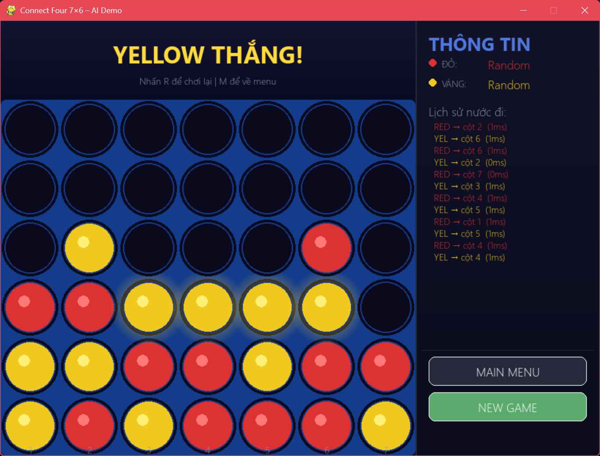

# Connect Four 7×6 – Game AI đa cấp độ


Đề tài cuối kỳ môn **Trí tuệ nhân tạo nâng cao** – Nhóm 11 – GVHD: TS. Đỗ Như Tài.
Xây dựng game Connect Four và các tác tử AI từ Random đến Alpha-Beta, MCTS và mạng nơ-ron, sau đó so sánh bằng giải đấu có kiểm soát ngân sách tính toán.



## Thành viên

| Họ tên | MSSV | GitHub | Phụ trách |
|---|---|---|---|
| Nguyễn Kiều Linh (nhóm trưởng) | 3124720039 | linh-245 | Engine, giao diện, Cấp 1–2, kiểm thử, solver, tích hợp |
| Nguyễn Huỳnh Mai | 3124720043 | chloestudy0043-stack | Alpha-Beta, MCTS, giải đấu, ablation |
| Nguyễn Lương Hồng Búp | 3124720009 | bupnguyen-19 | Dữ liệu, Neural Network, RL |

Tiến độ và phân công: xem tab **Projects** và **Issues**. Nhật ký đóng góp: [docs/CONTRIBUTIONS.md](docs/CONTRIBUTIONS.md).

## Các cấp tác tử

| Cấp | Tác tử | File | Trạng thái |
|---|---|---|---|
| 1 | Random | `agents/random_agent.py` | Đã có |
| 2 | Rule-based (Think1–3) | `agents/heuristic_agent.py` | Đã có |
| 3 | Alpha-Beta | `agents/alphabeta_agent.py` | Đã có; đang thêm cờ cắt tỉa, đếm nút, giới hạn thời gian |
| 4 | MCTS (UCT) | `agents/mcts_agent.py` | Đã có; đang thêm seed, ngân sách thời gian |
| 5 | Neural Network | `agents/nn_agent.py` | Đang thực hiện |
| 6 | Reinforcement Learning | `training/train_rl.py` | Đang thực hiện |

> Cập nhật cột "Trạng thái" mỗi khi hoàn thành một cấp. Chỉ ghi "Đã có" khi đã có test hoặc đã chạy thật.

## Cấu trúc thư mục

```
game/        Engine ConnectFourEnv (theo sách Liu, đã bổ sung API theo đề)
agents/      Các tác tử AI
training/    Sinh dữ liệu, huấn luyện SL và RL
eval/        Giải đấu round-robin, Wilson CI, ablation
ui/          Giao diện Pygame
tests/       Kiểm thử tự động
notebooks/   Notebook tạo bảng và hình từ log (chưa có; hiện notebook nằm ở eval/, tests/ và demo.ipynb)
weights/     Checkpoint mô hình, file nhỏ (sẽ có)
logs/        Log thi đấu thô (sẽ có)
docs/        Báo cáo, nhật ký đóng góp, hình
```

## Cài đặt và chạy

```bash
pip install -r requirements.txt

python ui/pygame_ui.py          # demo chơi: Human vs AI, AI vs AI
python -m pytest tests -q       # chạy kiểm thử
# giải đấu: mở eval/tournament.ipynb (chưa có bản .py)
```

Huấn luyện và giải đấu: xem `docs/README_learning.md` và `docs/README_eval.md` (thêm khi hoàn thành). Ghi rõ seed, số ván, cấu hình máy trong các file này.

## Kết quả

Bảng và hình nằm trong `results/` và được sinh lại từ `notebooks/`. Chỉ đưa vào README các số đã chạy thật (kèm seed, số ván, cấu hình).

| Nội dung | Link |
|---|---|
| Ma trận đối đầu | _chờ số liệu_ |
| Ablation | _chờ số liệu_ |
| Learning curve | _chờ số liệu_ |

## Phần kế thừa và phần nhóm tự làm

- **Kế thừa từ sách** Mark Liu, *AlphaGo Simplified* (CRC Press): khung engine kiểu Gym, Random, Think1–3, Alpha-Beta, MCTS cơ bản.
- **Nhóm tự làm / sửa / bổ sung:** sửa 3 lỗi (reward giải đấu, dấu lan truyền ngược MCTS, Think3), bổ sung API engine, giao diện, giải đấu, ablation, dữ liệu, mạng nơ-ron, RL, kiểm thử.

## Quy ước làm việc nhóm

- Commit message của đề tài cuối kỳ: `Duan_GameAl/<Khu vực>: <việc đã làm>`, ví dụ `Duan_GameAl/Engine: thêm undo()`. (Bài tập nhóm khác trong môn dùng `Tuan??/Bai??/Làm gì`.)
- Mỗi việc là một Issue; làm trên nhánh `feat/<tên>-<việc>`; gộp bằng Pull Request có người review.
- Chi tiết: [docs/GIT_WORKFLOW.md](docs/GIT_WORKFLOW.md).

## Tài liệu tham khảo

Allis (1988); Kocsis & Szepesvári (2006); Silver et al. (2016, 2017); Liu, *AlphaGo Simplified* (CRC Press); Russell & Norvig (2021); Sutton & Barto (2018).
