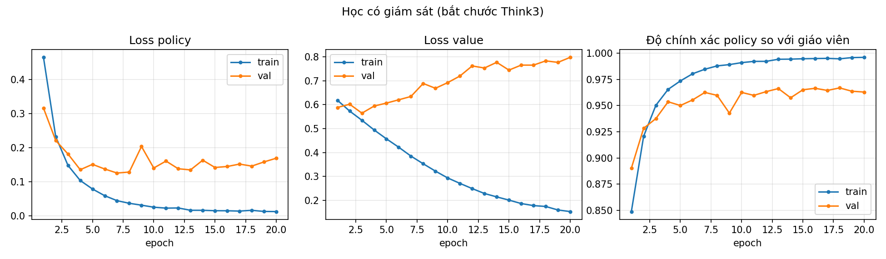

# Hướng dẫn phần học máy (cấp 5: Neural Network)

Phần này mô tả cách sinh dữ liệu, huấn luyện và dùng mạng policy-value cho Connect Four.
Chạy tất cả lệnh từ thư mục gốc của repo. Cần `torch`, `numpy`, `matplotlib`.

## Các file liên quan

| File | Vai trò |
|---|---|
| `training/encode.py` | Mã hóa thế cờ thành tensor 3×6×7 theo góc nhìn người sắp đi |
| `training/model.py` | Mạng CNN policy-value (conv 3×3, 3 khối residual, đầu policy 7 cột, đầu value tanh) |
| `training/generate_data.py` | Sinh dữ liệu từ ván tự đấu của agent giáo viên `conn_think3` |
| `training/dataset.py` | Loại thế trùng, chia train/val/test theo ván |
| `training/train_sl.py` | Huấn luyện có giám sát, lưu checkpoint và log |
| `training/plot_curves.py` | Vẽ đường cong học từ log CSV |
| `agents/nn_agent.py` | Agent cấp 5: chọn cột có xác suất policy cao nhất |
| `weights/sl.pt` | Checkpoint SL (epoch 4) |
| `weights/sl.json` | Log đầy đủ: tham số, seed, thiết bị, thời gian, lịch sử từng epoch |
| `logs/training/sl_log.csv` | Log từng epoch dạng CSV |
| `docs/images/sl_curves.png` | Đường cong học |

## Chạy lại từ đầu

```
python -m training.generate_data --games 5000 --seed 42 --out data/teacher_think3_5000.npz
python -m training.train_sl --data data/teacher_think3_5000.npz --epochs 20 --seed 0 --out weights/sl.pt
python -m training.plot_curves
```

Dữ liệu `.npz` không đưa lên GitHub (đã nằm trong `.gitignore`); sinh lại bằng lệnh đầu. Cùng seed thì cho kết quả giống nhau.

Dùng agent:

```python
from agents.nn_agent import nn_agent
move = nn_agent(env)   # mặc định đọc weights/sl.pt; trả về cột 1..7
```

## Cấu hình lần huấn luyện này

- Dữ liệu: 5000 ván giáo viên `conn_think3` (seed 42, 2 nước đầu ngẫu nhiên, mỗi nước sau 20% đi ngẫu nhiên) cho 130241 thế cờ; sau khi loại trùng còn 76175 thế.
- Chia theo ván (seed 0): train 60693, val 7863, test 7619 thế. **Tập test chưa được dùng** (chỉ chạy một lần ở cuối, sau khi chốt siêu tham số).
- Mạng: 64 kênh, 3 khối residual. Adam, lr 1e-3, weight decay 1e-4, batch 128, 20 epoch.
- Loss: cross-entropy (policy, che cột đầy) cộng 1,0 × MSE (value).
- Thiết bị: CPU. Python 3.13.5, torch 2.12.1. Thời gian huấn luyện: 514,2 giây.
- Checkpoint được chọn theo loss tổng (policy + value) trên tập val thấp nhất: epoch 4.

## Kết quả huấn luyện (trên tập val)

Epoch 4 (checkpoint): loss policy 0,136; loss value 0,595; độ chính xác policy so với giáo viên 0,954 (train 0,965).

Qua 20 epoch, độ chính xác policy trên val dao động quanh 0,95 đến 0,967; loss value trên val tăng từ 0,565 (epoch 3) lên 0,798 (epoch 20) trong khi trên train giảm đến 0,153.



## Lưu ý và hạn chế

- Đây là kết quả huấn luyện, **chưa phải kết quả thi đấu**. Sức mạnh của `nn_agent` sẽ được đo trong giải đấu của nhóm (khai cuộc ngẫu nhiên, đổi bên).
- Nhãn policy là nước đi của giáo viên `conn_think3`, nên mạng học bắt chước; sức mạnh bị giới hạn bởi giáo viên và có nguy cơ chỉ học lại heuristic.
- Đầu value học thuộc dữ liệu train (loss val tăng dần). Nhãn value là kết quả cả ván và bị nhiễu bởi các nước đi ngẫu nhiên. `nn_agent` hiện chỉ dùng policy, chưa kết hợp MCTS nên chưa dùng đến value.
- Cách chọn checkpoint theo loss tổng nghiêng về đầu value; chọn theo loss policy có thể cho độ chính xác policy cao hơn (đỉnh 0,967 ở epoch 18). Chưa thử.