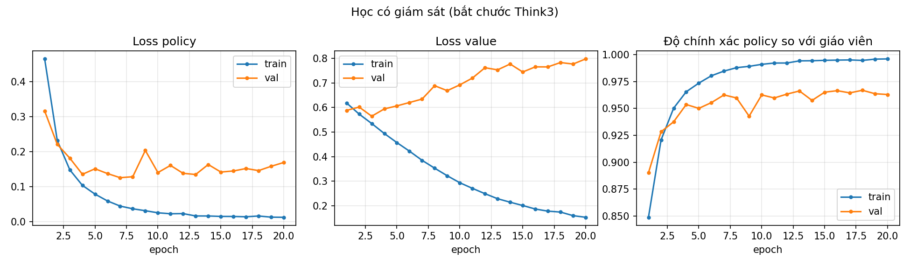

# Hướng dẫn phần học máy (cấp 5 đến 8)

Phần này mô tả cách sinh dữ liệu, huấn luyện và dùng mạng policy-value cho Connect Four: cấp 5 (học có giám sát), cấp 6 (tự chơi RL), cấp 7 (AZ-MCTS) và cấp 8 (tự chơi AlphaZero). Các mục đầu là cấp 5; cấp 6 đến 8 và kết quả thi đấu ở các mục cuối.
Chạy tất cả lệnh từ thư mục gốc của repo. Cần `torch`, `numpy`, `matplotlib`.

## Các file liên quan

| File | Vai trò |
|---|---|
| `training/encode.py` | Mã hóa thế cờ thành tensor 3×6×7 theo góc nhìn người sắp đi |
| `training/model.py` | Mạng CNN policy-value (conv 3×3, 3 khối residual, đầu policy 7 cột, đầu value tanh) |
| `training/generate_data.py` | Sinh dữ liệu từ ván tự đấu của agent giáo viên `conn_think3` |
| `training/dataset.py` | Loại thế trùng, chia train/val/test theo ván |
| `training/train_sl.py` | Huấn luyện có giám sát, lưu checkpoint và log |
| `training/plot_curves.py` | Vẽ đường cong học từ log CSV |
| `agents/nn_agent.py` | Agent cấp 5: chọn cột có xác suất policy cao nhất |
| `weights/sl.pt` | Checkpoint SL (epoch 4) |
| `weights/sl.json` | Log đầy đủ: tham số, seed, thiết bị, thời gian, lịch sử từng epoch |
| `logs/training/sl_log.csv` | Log từng epoch dạng CSV |
| `docs/images/sl_curves.png` | Đường cong học |
| `training/train_rl.py` | Cấp 6: tự chơi, policy gradient có baseline, khởi tạo từ `weights/sl.pt` |
| `training/eval_anchors.py` | Đo checkpoint với Random, Think1, Think2, Think3 (100 ván mỗi cặp, Wilson CI) |
| `training/plot_rl_curves.py` | Vẽ đường cong học RL (`results/figures/fig_learning_curve.png`) |
| `agents/az_mcts_agent.py` | Cấp 7: MCTS dùng PUCT, prior và value từ mạng |
| `training/selfplay.py` | Cấp 8: tự chơi bằng AZ-MCTS rồi huấn luyện lại mạng |
| `weights/rl.pt`, `weights/rl.json` | Checkpoint và tham số chạy RL |
| `weights/az_iter_1..10.pt` | Checkpoint sau mỗi vòng tự chơi cấp 8 |

## Chạy lại từ đầu

```
python -m training.generate_data --games 5000 --seed 42 --out data/teacher_think3_5000.npz
python -m training.train_sl --data data/teacher_think3_5000.npz --epochs 20 --seed 0 --out weights/sl.pt
python -m training.plot_curves
```

Dữ liệu `.npz` không đưa lên GitHub (đã nằm trong `.gitignore`); sinh lại bằng lệnh đầu. Cùng seed thì cho kết quả giống nhau.

Dùng agent:

```python
from agents.nn_agent import nn_agent
move = nn_agent(env)   
```

## Cấu hình lần huấn luyện này

- Dữ liệu: 5000 ván giáo viên `conn_think3` (seed 42, 2 nước đầu ngẫu nhiên, mỗi nước sau 20% đi ngẫu nhiên) cho 130241 thế cờ; sau khi loại trùng còn 76175 thế.
- Chia theo ván (seed 0): train 60693, val 7863, test 7619 thế. **Tập test chưa được dùng** (chỉ chạy một lần ở cuối, sau khi chốt siêu tham số).
- Mạng: 64 kênh, 3 khối residual. Adam, lr 1e-3, weight decay 1e-4, batch 128, 20 epoch.
- Loss: cross-entropy (policy, che cột đầy) cộng 1,0 × MSE (value).
- Thiết bị: CPU. Python 3.13.5, torch 2.12.1. Thời gian huấn luyện: 514,2 giây.
- Checkpoint được chọn theo loss tổng (policy + value) trên tập val thấp nhất: epoch 4.

## Kết quả huấn luyện (trên tập val)

Epoch 4 (checkpoint): loss policy 0,136; loss value 0,595; độ chính xác policy so với giáo viên 0,954 (train 0,965).

Qua 20 epoch, độ chính xác policy trên val dao động quanh 0,95 đến 0,967; loss value trên val tăng từ 0,565 (epoch 3) lên 0,798 (epoch 20) trong khi trên train giảm đến 0,153.



## Cấp 6: Reinforcement Learning (tự chơi)

```
python -m training.train_rl --iterations 300 --games 32 --seed 0 --save-every 50
python training/eval_anchors.py --ckpt weights/sl.pt --label SL --games 100
python training/eval_anchors.py --ckpt weights/rl.pt --label RL --games 100 --append
python -m training.plot_rl_curves --out results/figures/fig_learning_curve.png
```

- Cấu hình lần chạy thật: 300 vòng x 32 ván tự chơi, seed 0, lr 1e-4, khởi tạo từ `weights/sl.pt`, CPU, 435,8 giây (`weights/rl.json`).
- Trong log (`logs/training/rl_log.csv`), tự chơi chuyển từ bên đi trước thắng nhanh (vòng 1 đến 50) sang hòa đầy bàn (vòng 251 đến 300).
- Đo với Think2 (một seed, 100 ván): Win Score từ 0,275 (SL) lên 0,48 đến 0,62 (các mốc RL); với Think3 và Think1 chưa thấy khác biệt.
- Độ chính xác nước tối ưu trên 500 thế chuẩn (`python solver/optimal_accuracy.py`): NN (SL) 50,0%, RL 49,4%, nghĩa là RL chưa cải thiện độ chính xác nước tối ưu so với SL.

## Cấp 7: AZ-MCTS

`agents/az_mcts_agent.py`: mỗi nước chạy MCTS dùng công thức PUCT (c = 1,0); prior từ đầu policy, giá trị lá từ đầu value của mạng, chọn nước theo số lần thăm. Mặc định 200 mô phỏng và `weights/sl.pt`. Hai điểm dễ sai và đã được sửa:

- Giá trị lá là theo góc nhìn người **sắp đi** tại lá, nên khi lan truyền ngược phải đảo dấu theo độ sâu. Không so sánh `env.turn`, vì sau nước thắng `env.turn` không đổi.
- Khi chọn nút con dùng Q của nút con **đảo dấu** (Q của nút con là theo góc nhìn đối thủ).

Có `tests/test_az_mcts.py` (3 test: ăn nước thắng, chặn thắng dọc, chặn thắng ngang) chạy không cần checkpoint thật.

## Cấp 8: tự chơi kiểu AlphaZero

```
python -m training.selfplay --iterations 10 --games 40 --sims 50 --seed 0
```

- Mỗi vòng: 40 ván tự chơi bằng AZ-MCTS (50 mô phỏng/nước), 10 nước đầu lấy mẫu theo tỷ lệ số lần thăm để có khám phá, các nước sau chọn nước nhiều lượt thăm nhất; sau đó huấn luyện 3 epoch (loss = cross-entropy policy theo phân phối lượt thăm + MSE value theo kết quả ván; Adam lr 1e-3, batch 128), khởi tạo từ `weights/sl.pt`, seed 0.
- Mỗi vòng lưu `weights/az_iter_N.pt`; log ở `logs/training/selfplay_log.txt`. Trong giải đấu, `AZ8-N` là AZ-MCTS 200 mô phỏng dùng `weights/az_iter_N.pt`.
- Chạy mỗi vòng khoảng 87 đến 107 giây trên máy chạy; loss tổng giảm từ 1,2645 (vòng 1) xuống 0,3099 (vòng 10). Nhiều ván tự chơi kết thúc hòa đầy bàn (42 nước); nguyên nhân chưa được kiểm tra.

## Kết quả thi đấu (giải đấu 10 tác tử)

Seed 42, 100 ván mỗi cặp (4500 ván), Alpha-Beta độ sâu 7, MCTS 200 mô phỏng, không đặt ngân sách thời gian, 4 tiến trình song song (độ trễ chỉ so sánh tương đối). Tổng Win Score: AlphaBeta-7 8,44; MCTS-200 6,575; AZ8-10 6,36; AZ-MCTS 6,08; Think3 4,825; RL 4,29; NN (SL) 3,445; Think2 3,115; Think1 1,36; Random 0,51. Chi tiết: `logs/tournament_all10_run2_console.txt` và `_matrix.csv`.

- Tìm kiếm trên cùng mạng SL giúp rõ rệt: NN (SL) đấu AZ-MCTS được 0,245 (Wilson CI 0,171 đến 0,338).
- Cấp 8 chưa hơn cấp 7: AZ-MCTS vs AZ8-10 được 0,465 (CI 0,370 đến 0,562, chứa 0,5). Mới chạy 10 vòng nhỏ, một seed.
- Alpha-Beta độ sâu 7 vẫn mạnh hơn cả hai (0,865 và 0,845). AZ-MCTS tương đương MCTS-200 về sức mạnh nhưng chậm hơn nhiều (trung bình khoảng 123 ms so với 14 ms mỗi nước, khi chạy song song).

## Lưu ý và hạn chế

- Các số ở trên là kết quả huấn luyện, **không phải kết quả thi đấu**. Sức mạnh thi đấu của `nn_agent` đo trong giải đấu của nhóm (xem mục Kết quả thi đấu bên dưới).
- Nhãn policy là nước đi của giáo viên `conn_think3`, nên mạng học bắt chước; sức mạnh bị giới hạn bởi giáo viên và có nguy cơ chỉ học lại heuristic.
- Đầu value học thuộc dữ liệu train (loss val tăng dần). Nhãn value là kết quả cả ván và bị nhiễu bởi các nước đi ngẫu nhiên. `nn_agent` chỉ dùng policy; value chỉ được dùng ở cấp 7 và 8 (AZ-MCTS).
- Cách chọn checkpoint theo loss tổng nghiêng về đầu value; chọn theo loss policy có thể cho độ chính xác policy cao hơn (đỉnh 0,967 ở epoch 18). Chưa thử.